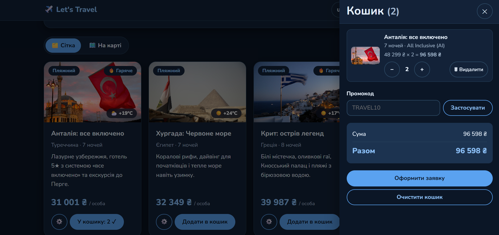

# Let's Travel — каталог турів із кошиком (Vue 3)

Лабораторна робота № 2 з дисципліни «Веб-технології».
Тема: **турагентство**. Каталог із 16 турів, фільтр, пошук, сортування, інтерактивна карта, жива погода, конвертер валют, конфігуратор туру, кошик із промокодами та електронний QR-ваучер.
Усе оновлюється одразу, без перезавантаження сторінки і без ручної роботи з DOM.



**Демо:** https://mafioznick63.github.io/letstravel-vue/

## Що вміє

- каталог із `public/products.json` (завантажується через `fetch`, є стани «завантаження» та «помилка»);
- **фільтр за категорією**, **пошук за назвою або країною** (`computed`) та сортування за ціною;
- **перемикач вигляду «Сітка / На карті»** на базі Leaflet з інтерактивними пінами та цінами;
- **живий конвертер валют (USD / UAH / EUR)** із підвантаженням актуального курсу з API НБУ;
- **поточна погода на курортах** через Open-Meteo API на картках і на карті;
- **конфігуратор туру**: вибір тривалості, типу харчування (BB / HB / AI) і кількості туристів із реактивним перерахунком ціни;
- **кошик**: додати тур, змінити кількість (+ / −), видалити, очистити; лічильник у шапці й сума оновлюються одразу;
- **кошик зберігається в `localStorage`** і не зникає після оновлення сторінки (`watch`);
- окремі повідомлення для порожнього кошика й для «нічого не знайдено»;
- промокоди `TRAVEL10` (−10 %) і `WELCOME5` (−5 %);
- оформлення заявки з перевіркою полів (`computed`) і генерацією **електронного ваучера (Boarding Pass) із QR-кодом**;
- перемикач теми Авто / Світла / Темна (запам'ятовується);
- адаптивна верстка (mobile-first, Grid, `rem`, `clamp()`), видимий фокус, `alt` у зображень.

## Компоненти

| Компонент | Призначення | props → | ← події |
|---|---|---|---|
| `SiteHeader.vue` | шапка, валюта, тема, лічильник кошика | `count`, `theme` | `open-cart`, `toggle-theme` |
| `FilterBar.vue` | пошук, категорії, сортування | `categories`, `total` | `v-model` через `defineModel` |
| `ProductCard.vue` | картка туру з погодою | `product`, `inCart`, `weather` | `add`, `configure` |
| `TourModal.vue` | конфігуратор ночей, харчування й осіб | `product`, `weather` | `close`, `confirm` |
| `ToursMap.vue` | інтерактивна карта турів (Leaflet) | `products`, `weatherMap` | `add`, `configure` |
| `CartPanel.vue` | панель кошика, промокод, підсумок | `lines`, `count` | `close`, `inc`, `dec`, `remove`, `clear` |
| `CartItem.vue` | рядок кошика з обраними опціями | `item` | `inc`, `dec`, `remove` |
| `CheckoutForm.vue` | форма заявки з валідацією | — | `submitted`, `cancel` |
| `BoardingPass.vue` | електронний ваучер із QR-кодом | `order` | `close` |

## Як запустити

Потрібен [Node.js](https://nodejs.org) (LTS).

```bash
npm install
npm run dev